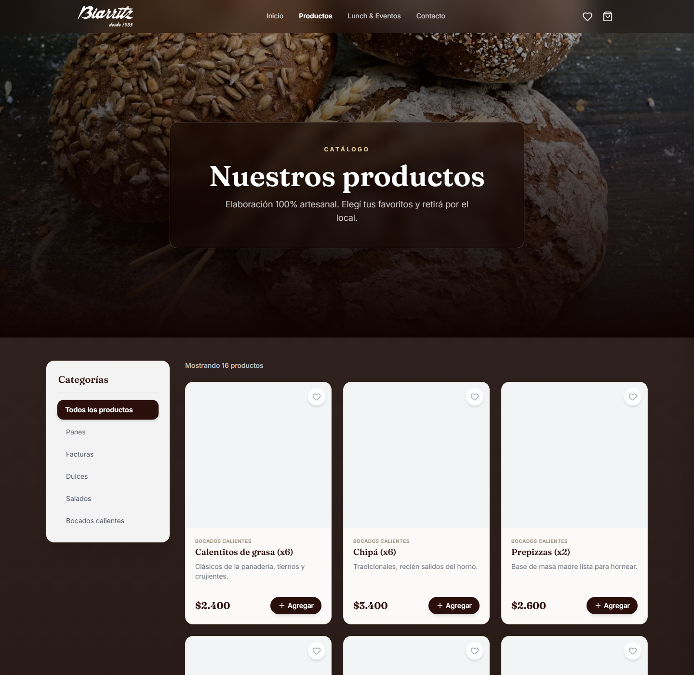
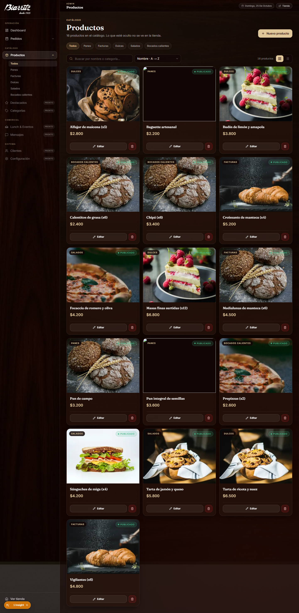
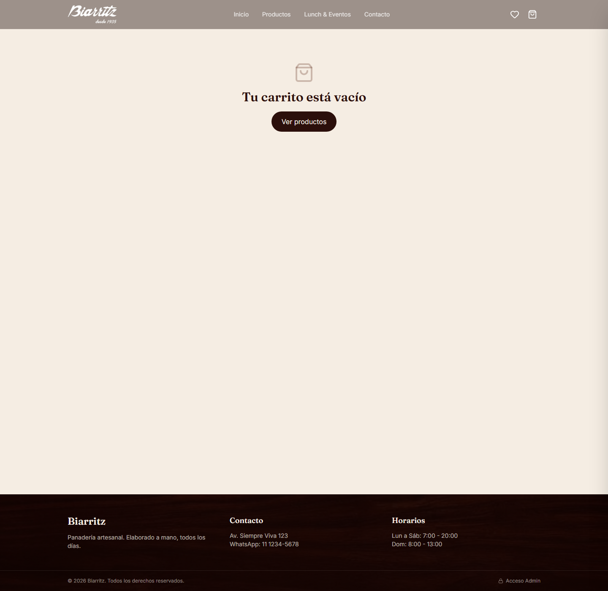
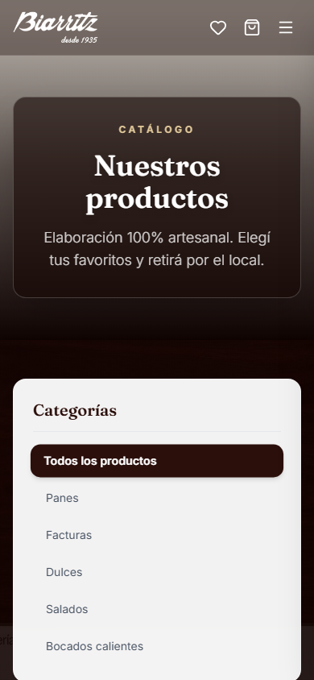
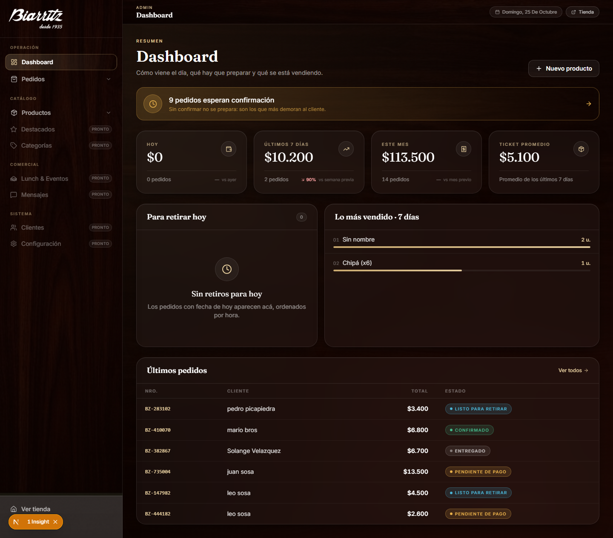

# Revisión de código — rotti-zeria (Biarritz)

**Fecha:** 25/10/2026 · **Método:** app levantada en `localhost:3000`, 10 capturas reales (1440 y 390 px) vía CDP, lectura del código, medición con script sobre 62 archivos JS/JSX y log del dev server.
**Diferencia con [`AUDITORIA-FRONT.md`](AUDITORIA-FRONT.md) (23/10):** esa auditoría se hizo **leyendo código sin ejecutar la app**. Esta se hizo **mirando la app**. Por eso encuentra cosas que la lectura no podía ver.

---

## 0. Veredicto

La app **corre**. La dirección visual se sostiene. Pero hay tres cosas que hoy la dejan fuera de producción, y una de ellas no estaba detectada:

1. **2 de 16 productos no tienen foto viva, y el catálogo entero se ve roto en la primera visita.** Dos imágenes devuelven 404/timeout de verdad; las otras 14 existen, pero se sirven por el optimizador de `next/image` y en caché fría no llegan a pintar a tiempo: la grilla queda en blanco. Ver §2.1 (corregido).
2. **El admin ya es un sistema de diseño; la tienda no.** El admin tiene 12 primitivos en `components/ui/` y **0 colores hardcodeados**. La tienda no importa ninguno de esos primitivos y concentra **161 literales hex en 10 archivos**.
3. **Sigue abierto el agujero de plata**: `app/api/orders/route.js` continúa calculando el total con los precios que manda el navegador.

---

## 1. Lo que mejoró desde la auditoría del 23/10

Conviene decirlo antes de la lista de problemas, porque es trabajo real:

| Antes | Ahora |
|---|---|
| No había capa de componentes | `components/ui/` con `button`, `field`, `panel`, `data-table`, `toolbar`, `search-field`, `view-toggle`, `confirm-dialog`, `status-badge`, `empty-state`, `skeleton`, `page-header`, `select` |
| El panel era un "segundo sistema" con hex a mano | **14 archivos del admin** usan los primitivos y el admin ya no tiene literales hex |
| No había `loading.jsx` | `admin`, `admin/pedidos`, `admin/productos` con skeletons |
| Editar producto daba 404 | Resuelto (confirmado en `lib/constants/nav.js` y `pedidos/[id]`) |

La deuda que queda **no es de gusto ni de sistema**: es que el sistema nuevo se aplicó **sólo a la mitad de la app**.

---

## 2. P0 — bloquea publicar

### 2.1 Fotos de producto: 2 muertas y la grilla entera se cae en frío (corregido)

> **Corrección.** La primera versión de este informe decía "las 16 tarjetas salen en blanco porque las URLs devuelven 404". **Eso era falso** y lo verifiqué después entrando al panel: en `/admin/productos` **14 de 16 fotos se ven**. Lo que sigue es la lectura correcta.

El catálogo público salió así en la primera carga:



Pero el panel, con los mismos `image_url` y el mismo `next/image`, las muestra:



Lo que dice el log del servidor:

```
⨯ upstream image response failed for https://images.unsplash.com/photo-1568471173242-461f0a7e6b3e?w=800&q=80 404
⨯ upstream image response timed out for https://images.unsplash.com/photo-1549931319-a545dcf3bc73?w=600&q=80
⨯ upstream image response timed out for https://images.unsplash.com/photo-1555507036-ab1f4038808a?w=600&q=80
```

Son **dos problemas distintos**:

1. **Contenido muerto (real, acotado).** Dos productos —*Baguette artesanal* y *Pan integral de semillas*— apuntan a fotos que ya no existen. En el panel salen en negro.
2. **Primera visita frágil (el que rompe la percepción).** Con la caché del optimizador vacía, 16 imágenes remotas se piden a la vez; las que no llegan a tiempo quedan en blanco. La grilla **no tiene placeholder ni skeleton ni `onError`**, así que el resultado es indistinguible de "no hay fotos". Cuando la caché está caliente (el caso del panel, 40 minutos después) todo se ve bien.

`next.config.mjs` está correcto y `ProductCard.jsx:52-65` no cubre el fallo: el `else` de "Sin imagen" sólo aplica si `image_url` es `null`, y acá el campo tiene valor aunque la imagen no cargue.

**Arreglo (en orden):**
1. Reemplazar las 2 fotos muertas y migrar el resto a Supabase Storage (host ya permitido en `remotePatterns`): deja de depender de Unsplash.
2. `placeholder="blur"` + `onError` → mismo estado que "Sin imagen", con un placeholder de marca. La grilla nunca queda en blanco mudo.
3. `priority` sólo en la primera fila, y `sizes` revisado (hoy `(max-width: 768px) 100vw, 33vw`).

> **Impacto:** es la página del catálogo. Con fotos a medias y una primera carga que parece vacía, no vende.

---

### 2.2 La API de pedidos sigue confiando el precio al navegador
`app/api/orders/route.js`

| Línea | Problema |
|---|---|
| `:10` | `total` se calcula con `items[].price` **que manda el cliente** |
| `:30-67` | Insert de orden y de ítems **sin transacción**: si fallan los ítems queda una orden huérfana |
| `:11` | `order_number` = `Date.now().slice(-6)` → colisiona (sin reintento, sin unicidad real) |
| `:52-60` | `product_name` / `product_image` se copian del body: el cliente puede escribir cualquier cosa en el historial |
| — | `orderSchema` (`lib/validations/order.js`) existe y **no se usa**; `is_available` no se verifica; el DNI se pide y nunca se guarda |

**Arreglo:** recalcular precios server-side desde `products`, y una función RPC de Postgres que inserte orden + ítems en una transacción. Un `order_number` secuencial por día (`BZ-251025-014`). Es medio día de trabajo y cierra el agujero.

---

### 2.3 `/checkout/exito` muestra datos bancarios inventados
`app/checkout/exito/page.jsx:26-46` — "Banco Ejemplo", cuenta `000-123456/7`, CBU `0000003100000000000000`, alias `BIARRITZ.PAN`. **Es una URL pública**: cualquiera que entre ve instrucciones de pago falsas. Antes de publicar hay que poner los datos reales o sacar el bloque.

### 2.4 El formulario de contacto no envía nada
`app/contacto/page.jsx:28-29`

```js
// TODO: conectar con tu backend (Supabase / email) antes de publicar.
setSent(true)
```

Muestra "Mensaje enviado" y el mensaje se pierde. Es el único canal de contacto del sitio.

### 2.5 Producto agotado se puede comprar
`app/productos/[id]/page.jsx:16-22` — la consulta del detalle no filtra `is_available` (la línea `:107` sí lo hace, pero para "relacionados"). Un producto oculto se sirve igual y se puede agregar al carrito.

### 2.6 `ClearCartOnMount` vacía el carrito de las otras pestañas
`components/ClearCartOnMount.jsx:9-11` — limpia al montar, sin comprobar que el pedido se haya creado en esa pestaña. Con `persist` en `localStorage`, afecta a todas.

### 2.7 Datos del local falsos en el pie de **todas** las páginas
`Av. Siempre Viva 123` · `WhatsApp: 11 1234-5678` (visible en la captura de checkout, abajo). El teléfono es argentino, la dirección es de Los Simpson y el país sigue sin definirse entre AR y UY.

---

## 3. P1 — dos sistemas de diseño conviviendo

Medido con script sobre los 62 archivos JS/JSX del proyecto:

| Métrica | Valor |
|---|---|
| Literales hex | **161**, concentrados en **10 archivos** (todos de la tienda) |
| Archivos del admin con `components/ui/` | **14** |
| Archivos de la tienda con `components/ui/` | **0** |
| Declaraciones de radio | **96**: `rounded-full` 53 · `rounded-xl` 24 · `rounded-2xl` 14 · `rounded-lg` 5 |
| `motion` instalado / archivos que lo importan | **sí / 0** |

Los diez archivos que cargan el hex son, en orden: `app/page.jsx` (30), `components/cart/CartDrawer.jsx` (29), `app/eventos/page.jsx` (23), `app/productos/[id]/page.jsx` (22), `app/contacto/page.jsx` (17), `components/ProductCard.jsx` (11), `components/Header.jsx` (10), `app/productos/page.jsx` (9).

**Conclusión:** no hay que "crear un sistema de diseño" — **ya existe**. Falta migrar la tienda a `components/ui/`, que es trabajo mecánico y de bajo riesgo. Mientras eso no pase, cada pantalla nueva de la tienda vuelve a inventar radios, sombras y marrones.

### 3.1 El header se lava sobre las páginas claras
`components/Header.jsx:31` es `fixed` con `bg-[#1a0806]/50` + `backdrop-blur`. Sobre el hero oscuro se ve perfecto; sobre `checkout`, `carrito` o `contacto` (fondos crema) el resultado es una barra gris lavada con el logo blanco encima. Se ve en la captura:



**Arreglo:** estado sólido al hacer scroll (o `bg` opaco en rutas sin hero). Es el patrón que ya insinuaba `Header.jsx:97` para el menú móvil.

### 3.2 `motion` está instalado y no se usa
Cero imports en 62 archivos. Toda la animación es CSS a mano (`globals.css`) y 53 `rounded-full` de botones. O se usa para los gestos que el sitio pide (drawer del carrito, feedback de "Agregar", transición de categorías) o se desinstala: hoy es peso muerto en `package.json`.

---

## 4. P2 — UX y rendimiento (medido, no supuesto)

### 4.1 En móvil, el catálogo no muestra ni un producto en la primera pantalla
`app/productos/page.jsx:114` — el `aside` de categorías es `w-full lg:w-64`: en el teléfono ocupa el ancho completo y **empuja la grilla una pantalla entera hacia abajo**. Sólo se ven seis links de categoría.



**Arreglo:** chips horizontales con scroll en `< lg`, sidebar sólo desde `lg`. No hay overflow horizontal (verificado: `scrollWidth 390 = clientWidth 390`), así que el ancho está sano; el problema es el orden.

### 4.2 Estado vacío con ~700 px de aire muerto
En `/checkout` sin ítems, el mensaje ocupa los primeros 280 px y el footer arranca a los 1040. Falta centrar verticalmente el bloque (`min-h` + `grid place-items-center`) o reducirlo.

### 4.3 Coste real de las texturas
`app/productos/page.jsx:8-14` usa `backgroundAttachment: 'fixed'` con un PNG de **1,6–2 MB**. En móvil eso es jank de scroll garantizado (Safari iOS lo ignora, Chrome Android lo repinta). Usar `position: relative` + una capa `absolute inset-0`, y texturas en WebP/AVIF de ≤150 KB.

### 4.4 El loop de desarrollo está roto de lento (y se cae)
No es cosmético: es lo que va a frenar cada iteración del equipo.

```
✓ Ready in 2.0min
GET /admin/pedidos 200 in 127s   (next.js: 118s)
GET /productos 500 in 61s        ← el loader de postcss se cae y la página queda en blanco
⨯ ./app/globals.css  Error: Node.js subprocess crashed while evaluating loaders [postcss]: failed to receive message
⚠ Slow filesystem detected. The benchmark took 266ms.
⚠ Next.js ignored package-lock.json in C:\Users\teamy because it is outside the current Git repository
```

- **Falta `turbopack.root`** en `next.config.mjs`: Next resuelve el workspace en `C:\Users\teamy`, un directorio con miles de archivos ajenos. Eso explica el arranque de 2 minutos y las compilaciones de 60–127 s.
- El **worker de PostCSS bajo carga muere** y devuelve **500 en `/productos`** con la página en blanco: cuando la máquina está ocupada, el catálogo deja de servirse.
- Escribir las capturas dentro del proyecto frena el watcher (`last modified: ".capturas/review"`). Conviene generarlas fuera del árbol.

**Arreglo:** `turbopack: { root: __dirname }` en `next.config.mjs`, sacar las capturas del árbol, y `.next` en disco local. Es un cambio de dos líneas con el mayor retorno de todo el informe.

---

## 5. El panel de admin (segunda pasada, con sesión real)

Entré con las credenciales que me pasaste y capturé 8 pantallas. **El panel es lo mejor del proyecto**: es un producto con identidad propia, no un dashboard blanco.

### 5.1 Lo que está bien y no hay que tocar

| Pantalla | Qué funciona |
|---|---|
| Dashboard | KPIs Hoy / 7 días / Mes / Ticket, banner **"9 pedidos esperan confirmación"**, *Para retirar hoy*, *Lo más vendido*, *Últimos pedidos* |
| Pedidos | tablero de tarjetas con **4 familias semánticas de color** (cian listo · verde confirmado · ámbar pendiente · neutro entregado), tabs con contadores exactos (14/9/2/2/1), búsqueda y toggle vista |
| Detalle de pedido | productos con foto y precio unitario, total, cliente + **botón WhatsApp**, entrega con día y hora, acciones primaria/peligro, imprimir |
| Productos | grilla con imagen, badge publicado, editar/borrar, filtros por categoría, orden, buscador |
| Móvil | sidebar → burger, tabs → `select`, tarjetas apiladas. **Resuelto sin overflow** (390 = 390) |

El mapa de estados que la auditoría anterior pedía (§4.3) **ya existe y se aplica**. `proxy.js` además protege todo `/admin/*` del lado del servidor y exige `app_metadata.role === 'admin'`: eso está bien hecho.

### 5.2 Bugs concretos que encontré mirándolo

1. **"Lo más vendido" muestra "Sin nombre" como el producto #1.** Los pedidos viejos tienen `order_items.product_name` nulo, porque ese campo lo escribe el cliente en `api/orders:55`. El ranking ordena por unidades y el primero de la lista es un fantasma. **Es el mismo bug que 2.2 visto desde la UI**: un dato de negocio que confía en el navegador termina en el reporte del dueño.
2. **A "Últimos pedidos" le falta la fecha.** Columnas: NRO · CLIENTE · TOTAL · ESTADO. Sin cuándo, un pedido de hace tres días se ve igual que uno de hace tres minutos.
3. **Las tarjetas de Pedidos no muestran el retiro.** Muestran `created_at` (22 oct - 02:01) pero no `pickup_date`/`pickup_time`, que es lo único que ordena el trabajo del día. Ese dato sí existe: está en el detalle.
4. **El teléfono no es accionable.** En el tablero el número es texto plano (y en un caso `00000000000`). Debería ser `tel:` + WhatsApp, como ya lo es en el detalle.
5. **El "×" de cada tarjeta no tiene `aria-label`** y cancela un pedido. Icono destructivo sin nombre accesible.
6. **6 de 9 ítems del menú son "PRONTO"**: Destacados, Categorías, Lunch & Eventos, Mensajes, Clientes y Configuración. El panel anuncia dos tercios de lo que no tiene.
7. **9 de 14 pedidos están en "pendiente de pago"**: sin pasarela, cada pedido es confirmación manual. Es una decisión de producto, pero el tablero lo está gritando.

Detalle del dashboard, con el ranking contaminado y la tabla sin fecha:



### 5.3 Detalles de acabado

- El detalle de pedido deja ~700 px vacíos bajo las acciones, y algo de la hoja de impresión ("Panadería Biarritz") se asoma al final del scroll en pantalla.
- Contraste bajo en las etiquetas de grupo del sidebar (`OPERACIÓN`, `CATÁLOGO`) y en los badges `PRONTO`: gris oscuro sobre marrón.
- El cian de "listo para retirar" es el único color frío en un sistema cálido. Funciona por contraste semántico, pero es el que menos pertenece.
- La píldora **"1 Insight"** flotante abajo a la izquierda es el indicador de desarrollo de Next (superpone botones reales en móvil). No es del producto: desaparece en `build`.

---

## 6. Lo que sigue sin verificar

- **Conteo definitivo de imágenes de la tienda.** El servidor devolvía 500 en `/productos` bajo carga (ver 4.4) y no pude medir cuántas fotos caen en frío. Sí está confirmado que **2 de 16 están muertas**.
- **El detector determinístico de Impeccable** (62 reglas): el motor corre, pero su Chrome embebido no arranca en este entorno (`0x80000003`). Lo de este informe es medición propia.
- **Pagos reales**: no hay pasarela, así que `/checkout/exito` sólo se juzga como copy.

---

## 7. Plan en tres tandas

**Tanda 0 — desbloquear el loop (30 min).**
`turbopack.root` en `next.config.mjs`. Capturas fuera del árbol. `.next` en disco local. Sin esto, cada tarea del resto del plan cuesta el triple.

**Tanda 1 — publicable (1 día).**
Las 2 fotos muertas + Storage + `placeholder`/`onError` en `ProductCard`. `product_name` y precios server-side en `api/orders` (arregla el ranking de paso). Datos reales o bloque eliminado en `/checkout/exito`. Datos reales del local en el footer y en `contacto`. Formulario de contacto real. `is_available` en el detalle.

**Tanda 2 — coherencia (1–2 días).**
Migrar la tienda a `components/ui/` (el admin ya es el patrón): **hex de 161 a 0**, radios de 96 a 3 escalas. Header con estado sólido. En el panel: fecha en *Últimos pedidos*, retiro en las tarjetas, teléfono accionable, `aria-label` en el "×".

**Tanda 3 — oficio (2 días).**
Chips de categoría en móvil. Estados vacíos centrados. Texturas optimizadas. `motion` aplicado donde suma o desinstalado. Pasada de accesibilidad de la tienda: los hallazgos 5.1 de la auditoría anterior (botones dentro de `<Link>`, drawer sin `role="dialog"`, foco visible) siguen abiertos.

---

## 8. Seguridad de la cuenta que me pasaste

La contraseña es `123456` y ahora está escrita en un chat. Antes de publicar: rotarla, y confirmar que `/admin/preview` (la rama sin autenticación de `proxy.js`) no puede alcanzarse en producción — hoy está protegida por `NODE_ENV !== 'production'`, que es correcto, pero conviene que la página además devuelva 404 como dice el comentario.

---

## 9. Cómo se generó esto

- Dev server: `npm run dev` (Next 16.4.0, Turbopack). Log completo leído para errores de imagen, compilación y el crash de PostCSS.
- Capturas públicas: `.tools/capture.mjs` → `.capturas/review/`: `home`, `productos`, `productos2`, `checkout`, `contacto`, `login`, `carrito`, `m-home`, `m-prod`.
- Capturas del panel: `.tools/admin-capture.mjs` (login real por CDP contra `#email`/`#password`, sin hardcodear credenciales) → `.capturas/admin/`: `dashboard`, `pedidos`, `producto-nuevo`, `productos`, `pedido-detalle`, `dashboard-mobile`, `pedidos-mobile`.
- Medición: `.tools/count.mjs` sobre `app/`, `components/`, `lib/`.
- Lectura directa: `app/api/orders/route.js`, `app/productos/page.jsx`, `app/productos/[id]/page.jsx`, `app/checkout/exito/page.jsx`, `app/contacto/page.jsx`, `app/admin/login/page.jsx`, `components/ProductCard.jsx`, `components/admin/ProductsTable.jsx`, `components/ClearCartOnMount.jsx`, `components/Header.jsx`, `lib/constants/nav.js`, `proxy.js`, `next.config.mjs`.
- Skills usadas: `impeccable` (contexto de auditoría). El detector quedó inutilizable en este entorno; todo lo cuantificado es medición propia.
